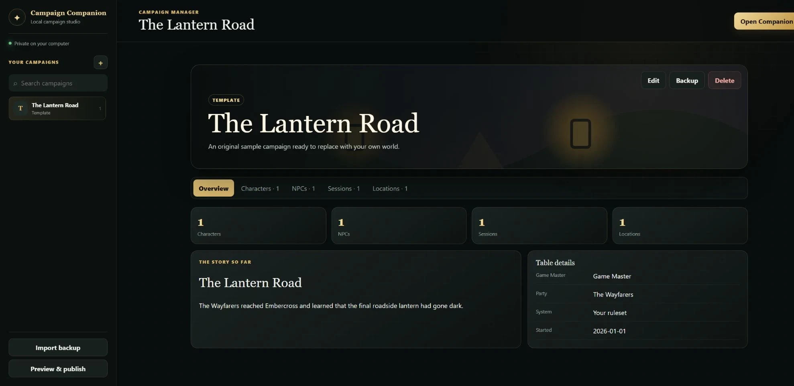
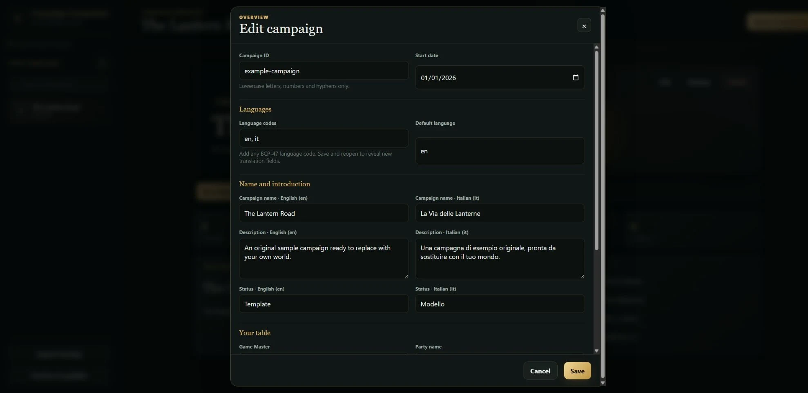
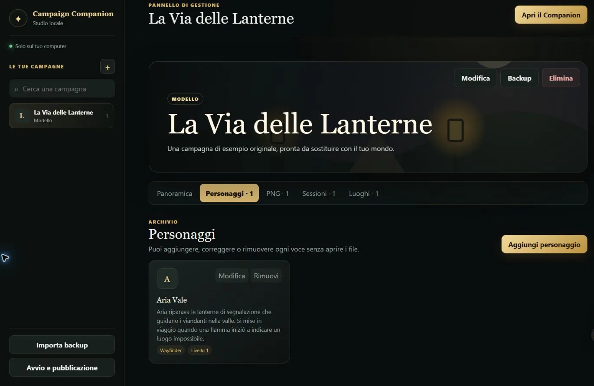
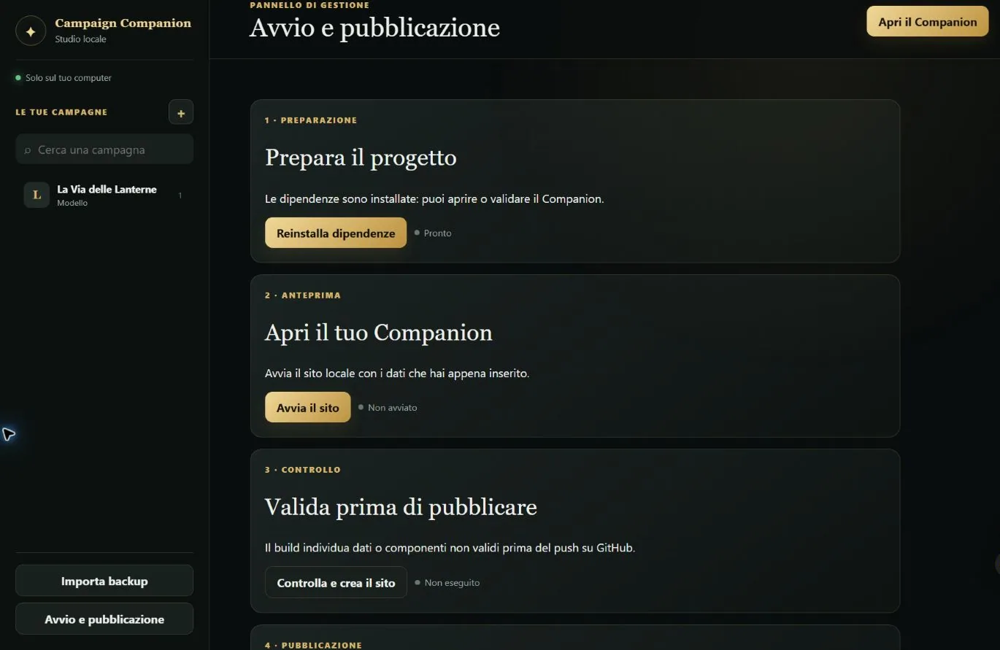

<p align="center">
  
</p>

<h1 align="center">Campaign Companion</h1>

<p align="center"><strong>Roll initiative against scattered campaign notes.</strong></p>

<p align="center">
  A beautiful, self-hosted archive for tabletop RPG campaigns—built for Game Masters who hoard lore and players who definitely remember the NPC's name.
</p>

<p align="center">
  
  
  
  
</p>

Campaign Companion turns characters, secret notes, NPCs, relationships,
session chronicles, locations and artwork into a responsive campaign website.
Its included visual manager means you can build the archive through friendly
forms—no JSON wrangling, folder copying or manifest bookkeeping required.

> **System-friendly by design.** The optional character sheet uses a familiar
> six-ability fantasy-RPG structure, while the campaign archive works for any
> tabletop system. No commercial rules, published adventure text or third-party
> artwork is included.

## Why your party will want it

| For the Game Master                                       | For the players                                             |
| --------------------------------------------------------- | ----------------------------------------------------------- |
| One searchable home for lore, NPCs and session history    | A beautiful place to revisit the adventure between sessions |
| Public profiles plus spoiler-protected character notes    | Character profiles, journals and level-by-level progression |
| Visual campaign editor with safe, recoverable deletion    | Styled character-sheet PDF exports                          |
| Original-image uploads, backups and build validation      | Mobile-friendly maps, galleries and relationship views      |
| Optional local Discord transcription and local-AI helpers | Language choice remembered on the device                    |

And yes, there is a spoiler warning. Once a visitor chooses to enter, the site
remembers—because defeating the same modal every session is not a heroic quest.

## The Campaign Manager

The manager is your local GM screen. It writes portable campaign files behind
the scenes while you work through a visual interface.

### 1. Gather the party

Open the dashboard to create a campaign, restore a backup or inspect your
existing archive at a glance.



### 2. Write in every tongue

Choose any campaign languages using standard codes such as `en`, `es`, `de`,
`ja`, `pt-BR` or `fr-CA`. Translation fields appear automatically for every
configured language; visitors select their preferred language from the site.



### 3. Chronicle the world

Add characters, NPCs, session recaps, locations and original artwork. The
manager validates IDs, places images correctly and keeps every index in sync.



### 4. Scout ahead, then publish

Prepare dependencies, preview the real site and run a production check from
one guided screen. When the omens are favorable, GitHub Actions can deploy it
to GitHub Pages.



## Quick start—no spellbook required

1. Install [Node.js 24](https://nodejs.org/).
2. Download this repository as a ZIP or clone it.
3. Launch the setup file for your platform:
   - **Windows:** double-click `setup.bat`
   - **macOS:** double-click `setup.command` (Control-click → **Open** the first time if prompted)
   - **Linux:** run `./setup.sh`
4. Your browser opens the local Campaign Manager. Create a campaign and start writing.

The manager listens only on `127.0.0.1`, requires no account and keeps your
campaign as ordinary files under `src/campaigns/`. Removed content is moved to
`.campaign-manager/trash/` whenever possible, so a misplaced click is not a
permanent disintegration spell.

The included original demo, **The Lantern Road**, is safe to explore, copy or
delete. Its protected example character uses the temporary password
`cambiami`; change or remove it before publishing real notes. This is a
client-side spoiler curtain, not strong security.

Need more detail? Read the [Campaign Manager guide](tools/campaign-manager/README.md).
Advanced authors can use the [campaign content guide](docs/CONTENT-GUIDE.md)
and edit the plain JSON directly.

## Language support

Campaign content supports any language or regional language code configured by
the author. The selector shows native language names when the browser supports
them, saves the visitor's choice locally and falls back to English—or the first
available translation—when a field has not been translated yet.

The built-in interface chrome currently includes polished English and Italian
copy; other selected languages receive the English interface with fully
localized campaign content. This keeps every campaign usable while additional
UI catalogs are contributed.

## Publish

### GitHub Pages

Push your copy to GitHub, open **Settings → Pages**, select **GitHub Actions**,
then run the included **Deploy to GitHub Pages** workflow. The repository base
path is calculated automatically.

### Any static web server

```bash
npm ci
npm run build
```

Upload `dist/campaign-companion/browser/` to your web root and configure SPA
fallback to `index.html`. Apache and Nginx examples live in
[docs/DEPLOYMENT.md](docs/DEPLOYMENT.md).

## Optional tools from the artificer's bench

### Discord transcription

`discord-transcriber/` contains an opt-in local voice transcription bot based
on faster-whisper. Audio is processed locally; temporary audio stays in memory
and Markdown transcripts remain on the machine running the bot. Obtain every
participant's informed consent and follow local law.

See the [Discord transcriber guide](discord-transcriber/README.md).

### Local AI helpers

`tools/local-ai/` can ask a local [Ollama](https://ollama.com/) model for an
original structured campaign draft and prepare prompts for a local
[ComfyUI](https://www.comfy.org/) installation. Nothing overwrites campaign
data automatically: the GM always reviews the draft first.

See the [local AI guide](tools/local-ai/README.md). You are responsible for the
licenses of the models, inputs and generated output you use.

## Safety, secrets and dragons

- Never commit `.env`, bot tokens, passwords, API keys or private transcripts.
- Client-side protected notes are shipped to the browser; do not store genuine secrets.
- Publish only text and images you created or have permission to redistribute.
- Do not add scanned books, copied rule text, published maps or adventure prose.
- This independent project is not affiliated with or endorsed by any tabletop publisher.

Code is released under the [MIT License](LICENSE). The sample campaign,
placeholders and repository artwork were created for this project and may be
reused under the same license.

---

<p align="center"><em>May your recaps be accurate, your secrets stay hidden, and your scheduling checks roll high.</em></p>
